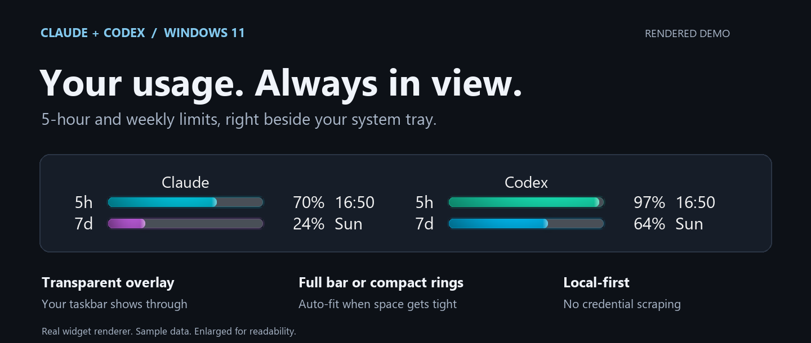
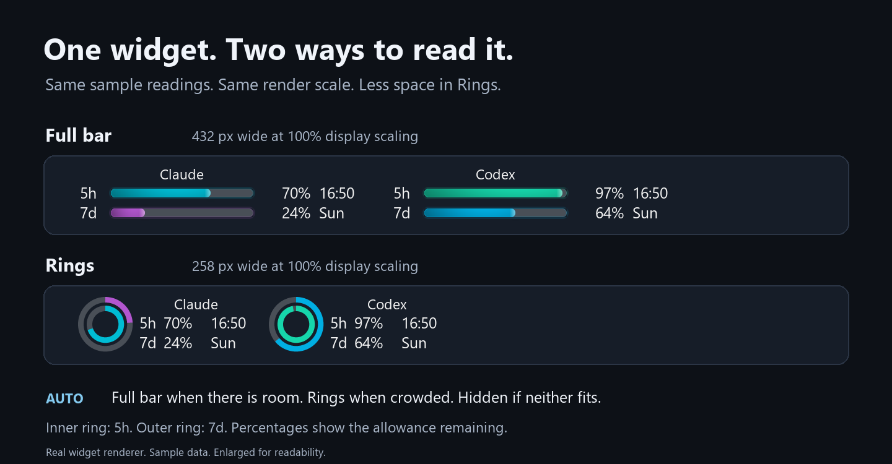
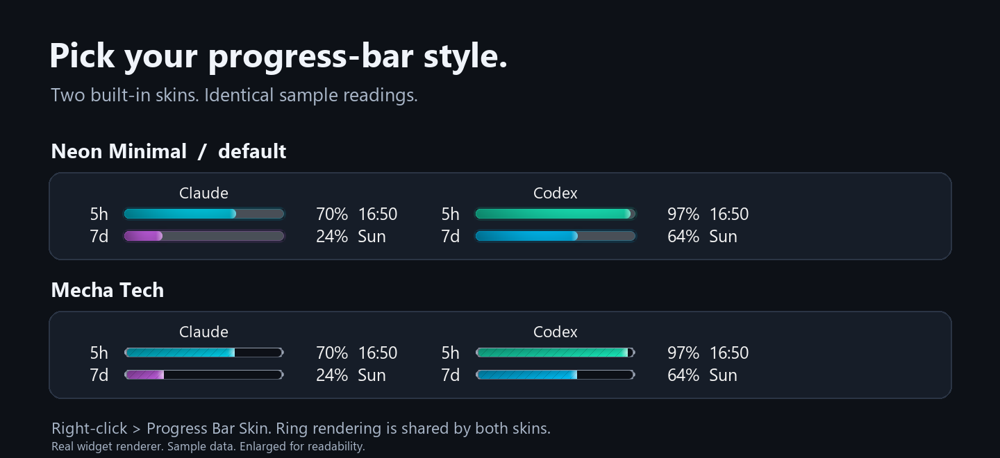

# claude-usage-bar

[English](README.md) | **简体中文**

**在 Windows 11 任务栏上，随时查看 Claude 和 Codex 的剩余额度。**

一个小巧、透明的任务栏组件，显示 **5 小时与每周窗口的剩余额度**及重置时间。支持完整进度条、紧凑双环，并可根据系统托盘旁的可用空间自动切换布局。



*图片由程序真实渲染器配合虚构示例数据生成，并经过放大以便阅读；不是实时桌面截图。*

[下载](https://github.com/imrooki/claude-usage-bar/releases) · [安装](#install) · [显示模式](#display-modes) · [刷新与隐私](#refresh-and-privacy) · [常见问题](#when-the-numbers-do-not-move)

> 如果你正在阅读发行 ZIP 中的文档，完整图文说明和中文版可在 [GitHub 在线文档](https://github.com/imrooki/claude-usage-bar#readme)中查看。

## 功能一览

- **两种用量，一处查看。** Claude 数据来自随项目提供的 Claude Code 插件；可选的 Codex 数据来自本地会话日志。
- **透明、轻量、不遮挡。** 位于通知区域旁，随系统托盘位置移动；全屏应用运行或任务栏设置为自动隐藏时，组件会隐藏。
- **进度条与紧凑双环。** Auto 根据任务栏空间自动选择布局，也可手动固定任一模式。
- **状态清晰可读。** 显示剩余百分比和重置时间；过期读数变灰，并标注读数距今多久。
- **本地优先。** 不提取登录凭据，不在后台请求账户用量。点击刷新时可选触发的请求见[下文](#refresh-and-privacy)。

<a id="display-modes"></a>

## 显示模式



| 模式 | 行为 |
|---|---|
| **Auto (fit taskbar)** — 默认 | 空间充足时显示完整进度条；任务栏拥挤时改用双环；两种布局都放不下时暂时隐藏。 |
| **Full bar** | 始终使用横向进度条。 |
| **Rings** | 使用双环，并在旁边显示提供方名称、百分比和重置时间，占用空间更小。 |

**百分比表示剩余额度，而不是已用额度。** 进度条越满，余量越充足。随着额度减少，颜色由绿色依次经过青色、蓝色、紫色，最终变为红色。Rings 模式中，**内环表示 5h，外环表示 7d**。

<details>
<summary><strong>进度条皮肤：Neon Minimal 与 Mecha Tech</strong></summary>



在右键菜单的 **Progress Bar Skin** 中选择皮肤，默认为 Neon Minimal。皮肤仅改变完整进度条的样式，两种皮肤共用同一套双环绘制方式。所有预览均使用程序真实渲染器和示例数据生成。

</details>

## 运行要求

| 项目 | 要求 |
|---|---|
| 系统 | Windows 11；主显示器的任务栏位于屏幕底部或顶部。项目在 build 26100 上开发，并在 build 26200、100% 显示缩放下测试。 |
| Claude | Claude Pro 或 Max 套餐，以及支持 mod 的 Claude Code。Code 会话中必须加载随项目提供的 `usage-feed` 插件。 |
| 源码安装 | Python 3 和 [Pillow](https://pypi.org/project/pillow/)；开发时使用 Python 3.13 与 Pillow 11。发行 ZIP 已内置 Python。 |
| 可选 Codex 显示 | 已使用 ChatGPT 套餐登录的 Codex CLI 或 Codex app，并有本地会话日志。点击刷新还需要原生 `codex.exe`。 |
| 可选 Claude 账户刷新 | Claude 桌面应用中有一个保持打开、已加载插件的 Code 会话。终端会话无法提供桌面应用的用量工具。 |

Windows UI Automation 由系统内置，无需额外安装包。已测试的 Claude Code 版本和集成注意事项见[技术参考（英文）](docs/REFERENCE.md#how-it-works)。

<a id="install"></a>

## 安装

### 使用发行 ZIP — 无需安装 Python

1. 从 [Releases](https://github.com/imrooki/claude-usage-bar/releases) 下载 `claude-usage-bar-<version>-<commit>.zip`，并使用配套的 `.sha256` 文件核对校验值。
2. 将**整个文件夹**解压到本地目录，例如 `C:\Tools\claude-usage-bar`。不要放在 OneDrive 或网络共享目录中。
3. 按下方[手动安装](#install-by-hand)中的**第 2 步**配置 Claude Code 插件。单独运行可执行文件无法获取 Claude 用量。
4. 完全退出并重新启动 Claude 桌面应用，再运行 `claude-usage-bar.exe`。
5. 打开一个**新的** Code 会话并发送一条消息。收到回复后，用量通常会在约 15 秒内显示。

请将 `plugins` 和 `data` 保留在可执行文件旁。由于程序尚未签名，Windows SmartScreen 可能提示警告；请先核实下载来源和校验值，再决定是否运行。ZIP 内还附有 `INSTALL.txt`。

<a id="install-by-hand"></a>

### 手动安装

#### 1. 获取源码与依赖

在不属于 OneDrive 或网络共享的本地目录中运行：

```powershell
git clone https://github.com/imrooki/claude-usage-bar.git
cd claude-usage-bar
mkdir data
python -m pip install pillow
claude plugin validate ./plugins/usage-feed
```

安装 Pillow 和运行 `pythonw` 时，请使用同一个 Python 安装环境。插件写入前，数据文件夹必须已存在；组件启动时也会自动创建它。

#### 2. 加载 Claude Code 插件

使用 **Claude 桌面应用的 Code 标签页**时，先备份 `%USERPROFILE%\.claude\settings.json`，再合并以下配置。**保留所有现有设置**，并将示例路径改成你的实际目录：

```json
{
  "env": {
    "CLAUDE_CODE_PLUGIN_DIRS": "C:\\Tools\\claude-usage-bar\\plugins\\usage-feed"
  },
  "pluginConfigs": {
    "usage-feed@inline": {
      "options": {
        "dataDir": "C:/Tools/claude-usage-bar/data"
      }
    }
  }
}
```

- `dataDir` 必须是**使用正斜杠的本地绝对路径**。相对路径、UNC 路径以及含有 `onedrive` 的路径会被拒绝。
- 如果已有 `env` 或 `pluginConfigs` 对象，请将新增内容合并进去，不要重复创建同名键，也不要覆盖整个对象；保留已有插件配置。
- 桌面会话请使用上述从文件夹加载插件的方式。在 Claude Code 2.1.286 的测试中，从 marketplace 安装的副本虽然被加载，但其 hook 在桌面应用中没有运行。如果已安装该副本，可用 `claude plugin disable usage-feed@usage-bar-local` 将其禁用。
- 修改设置后，请完全退出并重启桌面应用。已经打开的 Code 会话会继续使用此前加载的插件。

<details>
<summary><strong>仅使用终端版 Claude Code 时的安装方式</strong></summary>

如果只使用终端，可不采用桌面应用的文件夹加载配置，而是注册项目附带的本地 marketplace：

```powershell
claude plugin marketplace add ./plugins
claude plugin install usage-feed@usage-bar-local --config dataDir=C:/Tools/claude-usage-bar/data
```

将数据路径改成你的实际目录，然后打开新的终端会话。自动更新用量仍然可用，但终端会话没有 Claude 桌面应用的账户刷新工具。

</details>

#### 3. 启动组件，并打开新的 Code 会话

```powershell
pythonw usage_widget.py
```

如果使用发行 ZIP，则双击 `claude-usage-bar.exe`。随后打开一个新的 Claude Code 会话并发送一条消息，检查 `data/usage.json` 是否生成，以及组件是否显示读数。存在本地 sessions 文件夹时，Codex 会被自动检测；Codex 显示不需要额外插件。

默认情况下，组件和插件共用脚本或可执行文件旁的 `data` 目录。如果传入 `--data-dir <folder>`，请确保它与插件的 `dataDir` 指向**同一个文件夹**。

希望由编程助手协助安装？可使用[可复制的部署提示词（英文）](docs/AI_SETUP.md)。

## 使用方法

| 操作 | 效果 |
|---|---|
| 横向拖动 | 移动组件，并保存位置。 |
| 右键 → **Snap to tray** | 恢复自动跟随系统托盘的位置。 |
| 右键 → **Display** | 选择 Auto、Full bar 或 Rings。 |
| 右键 → **Progress Bar Skin** | 为完整进度条选择 Neon Minimal 或 Mecha Tech 皮肤。 |
| 右键 → **Refresh now** | 重新读取本地数据；除非已禁用，还会请求新的账户读数。请先阅读下方的额度消耗和隐私说明。 |
| 右键 → **Quit** | 退出组件。 |

**开机启动：**按 Win+R，运行 `shell:startup`，将可执行文件的快捷方式放入打开的文件夹。源码安装时，将快捷方式目标设为你的 `pythonw.exe`，参数设为带双引号的 `usage_widget.py` 完整路径。同一时间只运行一个组件实例。

**更新：**先退出组件。使用发行版时，用新 ZIP 中的版本替换可执行文件和 `plugins`，保留 `data` 与现有设置。源码安装时，更新本地检出目录，不要丢弃已有修改。之后重新启动组件，并打开新的 Code 会话；已打开的会话仍使用旧版插件。更多限制见[技术参考（英文）](docs/REFERENCE.md#using-the-widget)。

<a id="refresh-and-privacy"></a>

## 刷新与隐私

组件每 **15 秒**重新读取本地文件。它只能显示数据源已经写入的读数，**并不是实时账户用量 API**。读数超过 **30 分钟**未更新时会变灰，并标注距今多久；某一行的重置时间已过时，会显示 `reset`，直到收到新数据。

| 数据源 | 常规更新方式 | 默认情况下，**Refresh now** 额外执行的操作 |
|---|---|---|
| **Claude** | Code 完成一轮回复或发生额度事件后，插件写入用量。 | 请一个打开的桌面 Code 会话调用应用自身的用量工具。这是账户工具调用，不是模型提示词请求。通常每 60 秒最多成功请求一次。 |
| **Codex** | 从本地 Codex 会话日志读取额度记录。 | 启动你已登录的 Codex CLI，发出一次小型模型请求，默认使用 `gpt-6-luna`。**这会消耗少量 Codex 额度**，并留下会话日志；最多每 5 分钟一次。 |

**后台轮询不会自动发送刷新请求。** 组件本身不建立网络连接，也不会打开登录 token、cookie 或 `auth.json`。可选的刷新请求仅在点击后，由 Claude Code 会话或你自己的 Codex CLI 发出。组件会在本地扫描 Codex 日志末尾的用量记录，不使用对话内容生成显示数据。

如果希望保留两种用量显示，同时禁用两项对外刷新操作：

```powershell
pythonw usage_widget.py --no-app-refresh --no-codex-ping
```

发行版可在快捷方式的 `claude-usage-bar.exe` 后附加相同参数。本地轮询与手动重新读取仍然可用。

Claude 桌面应用的用量工具和 Codex 会话日志格式都**不是稳定、公开承诺的集成接口**；它们发生变化时，读数可能过期或无法获取。具体请求行为、以往的额度消耗测量、超时规则和数据处理方式见[Claude 刷新](docs/REFERENCE.md#app-refresh)、[Codex 用量](docs/REFERENCE.md#codex-usage)及[更新时序](docs/REFERENCE.md#when-the-numbers-change)（均为英文）。

### 启动参数

| 参数 | 用途 |
|---|---|
| `--data-dir <folder>` | 更改组件的数据目录；必须与 Claude 插件配置一致。 |
| `--no-app-refresh` | 禁用 Refresh now 触发的 Claude 账户工具请求。 |
| `--no-codex` | 隐藏 Codex，同时禁用其刷新请求。 |
| `--no-codex-ping` | 仅从本地日志显示 Codex，不启动 CLI 请求。 |
| `--codex-home <folder>` | 读取另一个 Codex home；刷新时也使用该目录。 |
| `--codex-bin <file>` | 指定现有的原生 `codex.exe`，不能使用 `.cmd` 包装脚本。 |
| `--codex-ping-model <name>` | 当默认刷新模型不适用于你的套餐时，指定其他模型。 |

<a id="when-the-numbers-do-not-move"></a>

## 数字不显示或不更新时

请先检查目录路径、插件是否加载，以及安装或更新后是否打开了**新的** Code 会话。远端使用情况只有在本地数据源报告新的账户额度后，才会反映在组件中。

| 显示内容 | 检查事项 |
|---|---|
| `--`、`no data` 或 `no file` | 让 Code 完成一轮回复；检查 `data/usage.json` 是否存在，以及组件与插件的数据路径是否一致。Codex 需要包含额度记录的本地非 ephemeral 会话。 |
| `same HH:MM` | 数据源的最新读数没有变化，不代表组件故障。 |
| 灰色进度条或读数年龄标签 | 最新读数已超过 30 分钟，需要让数据源提供新读数。 |
| `no session` | 保持一个桌面应用的 Code 会话打开，并通过文件夹方式加载插件。终端会话无法响应桌面应用工具请求。 |
| `no limits` | 应用已响应，但该账户没有可报告的订阅额度，例如使用 API key 的账户。 |
| `cooldown` | 等待冷却结束后再刷新。Claude 与 Codex 的冷却分别计算。 |
| `ping failed` | 检查 Codex 登录状态、原生 CLI 路径和模型可用性，并查看 `data/widget_error.log`。 |
| `read error` 或 `not sent` | 检查本地文件权限和错误日志。 |

插件的排查日志为 `data/usage-feed-events.json`。请查找新会话对应的 `session.start` 和 `session.measure` 记录。全部状态文字、日志字段和读数合并规则见[详细排查指南（英文）](docs/REFERENCE.md#when-the-numbers-do-not-move)。

### 已知限制

- 仅支持**主显示器**的任务栏。组件位于托盘旁，而非托盘内部，且**无法为自身预留任务栏空间**。
- 连紧凑双环也放不下时，Auto 会隐藏组件。如果 UI Automation 不可用，Auto 根据任务栏对齐方式回退：按钮居中时使用双环，左对齐时使用完整进度条。
- 任一显示器上有普通应用覆盖整个屏幕，或任务栏设置为自动隐藏时，组件会隐藏。
- 关闭右键菜单后，键盘焦点会留在组件上，直到点击其他窗口。
- 账户工具或日志格式的变化可能导致可选集成失效。Explorer 重启恢复和系统时钟异常等边界情况见[技术参考（英文）](docs/REFERENCE.md#using-the-widget)。

<a id="development"></a>

## 开发

应用使用 Python、Pillow 和 Windows API。Claude Code 插件位于 `plugins/usage-feed`；组件按数据、渲染、Windows 集成和应用逻辑拆分在 `usage_bar` 模块中。

- [架构、数据格式与目录结构（英文）](docs/REFERENCE.md#design-notes)
- [测试与发行版构建说明（英文）](docs/REFERENCE.md#building-a-release) — 原生窗口测试和真实 Codex 请求测试均须显式启用。
- [文档图片说明（英文）](docs/images/README.md) — 使用 `docs/render_previews.py` 离线生成、可复现的预览，不读取你的实际用量数据。

## 卸载

退出组件，并删除其开机启动快捷方式（如果创建过）。在 `%USERPROFILE%\.claude\settings.json` 中，仅移除本项目对应的插件目录项和 `usage-feed@inline` 配置，保留无关设置。使用 marketplace 安装时，运行：

```powershell
claude plugin marketplace remove usage-bar-local
```

如果不再需要本地数据，最后再删除项目文件夹。

## 许可证与免责声明

[MIT](LICENSE)。本项目为非官方项目，与 Anthropic 或 OpenAI 没有关联，也未获得其背书。Claude 桌面应用的用量工具和 Codex 日志格式可能变化。可选的 Codex 刷新会使用你自己已登录的 CLI，并消耗少量套餐额度；请自行确认是否适合你的套餐，或通过 `--no-codex-ping` 禁用。
